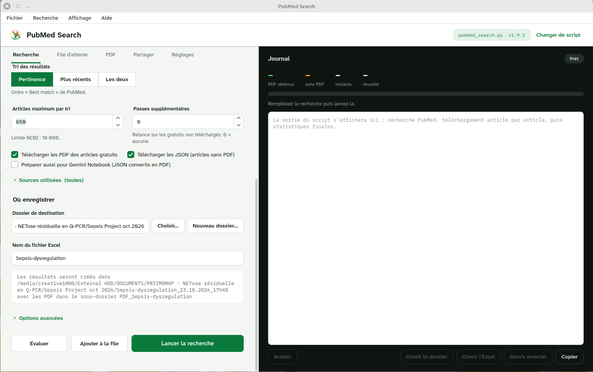
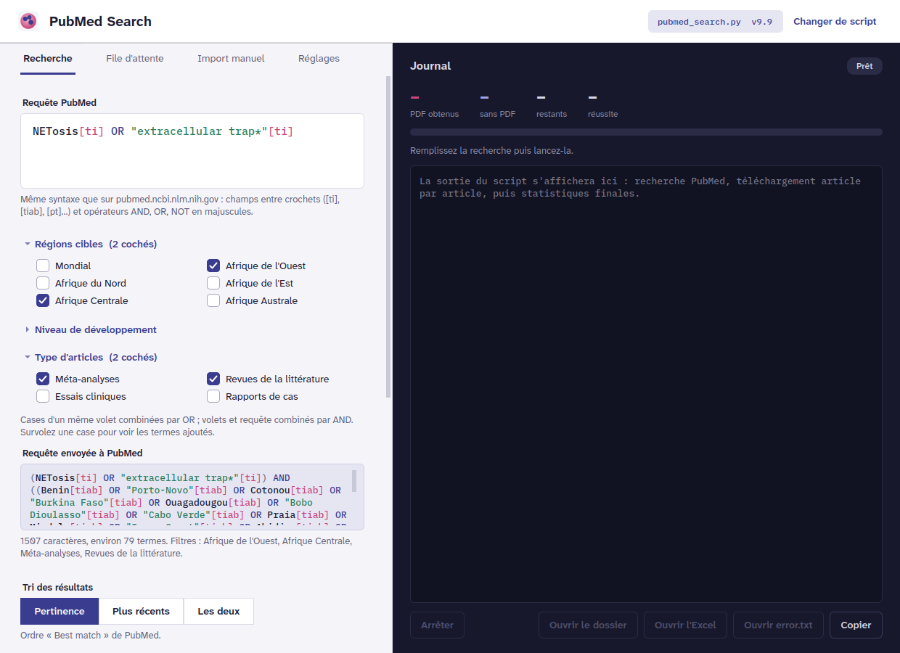
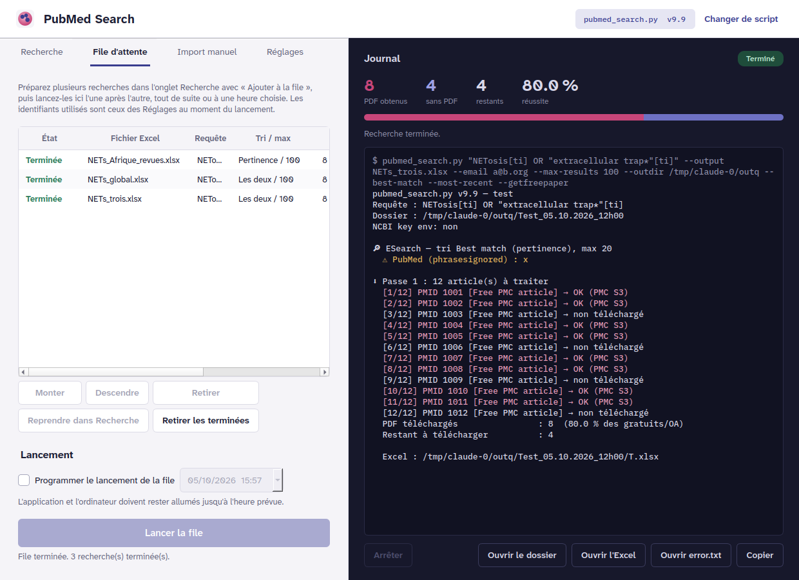

# PubMed Search

Rechercher dans PubMed et télécharger automatiquement les PDF des articles en libre accès,
avec un tableau Excel récapitulatif. Application de bureau pour **Windows 10 / 11**,
**macOS 12+ (Apple Silicon et Intel)** et **Linux (Ubuntu, Debian, Mint)**, avec une extension **Firefox** qui envoie une recherche
PubMed vers l'application en un clic.



## Télécharger

Page des téléchargements : **[Dernière version](https://github.com/sergesawadogo/pubmed-search/releases/latest)**

| Fichier | Pour |
|---|---|
| `PubMedSearch-Setup-1.8.2.exe` | Windows 10 et 11 (64 bits) |
| `PubMedSearch-1.8.2-macOS-AppleSilicon.dmg` | Mac à puce Apple (M1, M2, M3, M4…), macOS 12 Monterey ou plus récent |
| `PubMedSearch-1.8.2-macOS-Intel.dmg` | Mac à processeur Intel, macOS 12 Monterey ou plus récent |
| `pubmed-search-gui_1.8.2_amd64.deb` | Ubuntu 20.04+, Debian 10+, Linux Mint 20+ (64 bits) |
| `envoyer-vers-pubmed-search-1.0.0.xpi` | Extension Firefox (facultative) |
| `SHA256SUMS.txt`, `SHA256SUMS-macOS.txt` | Empreintes pour vérifier les fichiers |

Rien d'autre à installer : Python et ses bibliothèques sont inclus dans l'application.

---

## Installation

### Windows 10 / 11

1. Téléchargez `PubMedSearch-Setup-1.8.2.exe` et double-cliquez dessus.
2. Windows affiche « Windows a protégé votre ordinateur » : l'installateur n'est pas signé
   numériquement. Cliquez sur **Informations complémentaires**, puis **Exécuter quand même**.
3. Acceptez la demande d'autorisation administrateur, choisissez le dossier, terminez.
4. Lancez **PubMed Search** depuis le menu Démarrer (ou le Bureau si vous avez coché l'option).

Désinstallation : Paramètres → Applications → PubMed Search → Désinstaller.
Vos réglages (`%LOCALAPPDATA%\pubmed-search-gui`) sont conservés.

### macOS (Apple Silicon ou Intel)

1. Quel fichier ? Menu  → **À propos de ce Mac** : « Puce Apple M… » → fichier
   `…-AppleSilicon.dmg` ; « Processeur Intel… » → fichier `…-Intel.dmg`.
2. Ouvrez le `.dmg` et glissez **PubMed Search** sur le dossier **Applications**.
3. Premier lancement : l'application n'est pas signée par un certificat Apple ni notariée,
   macOS la bloque (« Apple ne peut pas vérifier… »). Cliquez sur **OK**, puis ouvrez
   **Réglages Système → Confidentialité et sécurité**, descendez jusqu'au message concernant
   PubMed Search et cliquez sur **Ouvrir quand même** (mot de passe demandé). Les fois
   suivantes, elle s'ouvre normalement.
   Alternative dans le Terminal :
   `xattr -dr com.apple.quarantine "/Applications/PubMed Search.app"`
4. Les liens `pubmedsearch://` de l'extension Firefox fonctionnent une fois l'application
   lancée au moins une fois depuis le dossier Applications.

Désinstallation : glissez **PubMed Search** du dossier Applications vers la Corbeille.
Vos réglages (`~/Library/Preferences/pubmed-search-gui`) sont conservés.

### Linux (Ubuntu, Debian, Linux Mint)

```bash
cd ~/Téléchargements
sudo apt install ./pubmed-search-gui_1.8.2_amd64.deb
```

`apt` installe aussi les bibliothèques graphiques nécessaires. Lancez **PubMed Search**
depuis le menu des applications, ou `pubmed-search-gui` dans un terminal.

Désinstallation : `sudo apt remove pubmed-search-gui`.

### Extension Firefox (facultative)

L'extension ajoute un bouton **Envoyer vers PubMed Search** sur pubmed.ncbi.nlm.nih.gov.
Elle n'est pas encore signée par Mozilla, ce qui limite son installation :

- **Firefox classique** : installation temporaire, à refaire après chaque redémarrage de Firefox.
  Tapez `about:debugging` dans la barre d'adresse → **Ce Firefox** →
  **Charger un module complémentaire temporaire…** → choisissez le fichier `.xpi`.
- **Firefox Developer Edition, Nightly ou ESR** : installation permanente.
  Dans `about:config`, passez `xpinstall.signatures.required` à `false`, puis glissez le
  fichier `.xpi` dans une fenêtre Firefox et confirmez.

Au premier envoi, Firefox demande quelle application doit ouvrir les liens
« pubmedsearch » : choisissez **PubMed Search** et cochez « Toujours utiliser ».

---

## Premier démarrage

Ouvrez l'onglet **Réglages** :

1. **Email** (obligatoire) : NCBI et Unpaywall demandent une adresse de contact.
2. **Clé API NCBI** (recommandée, gratuite) : 10 requêtes par seconde au lieu de 3.
   Créez-la sur [ncbi.nlm.nih.gov](https://www.ncbi.nlm.nih.gov/account/) → Account settings
   → API Key Management.
3. **Clé API CORE** (facultative) : copies d'articles dans les dépôts d'universités.
   Gain modeste, recherches plus lentes.
   **Clé API Elsevier** (facultative, dev.elsevier.com) : attention, Elsevier ne sert le texte
   intégral par API qu'aux requêtes venant du réseau d'une institution abonnée, ou munies d'un
   **jeton institutionnel** (insttoken, à demander à la bibliothèque). Hors de ces cas, la clé
   seule est refusée (AUTHENTICATION_ERROR), même pour des articles gratuits du Lancet.
4. **Clés Springer Nature** (facultatives, gratuites sur
   [dev.springernature.com](https://dev.springernature.com)) : *Open Access API* (texte intégral
   en JSON des articles BMC, SpringerOpen, Nature Communications…) et *Meta API* (lien PDF des
   articles Springer libres, résumés). Si une seule clé couvre les deux API, saisissez-la deux fois.
5. Cochez **Mémoriser les clés API** pour ne pas les saisir à chaque fois. Elles sont alors
   enregistrées en clair dans le fichier de réglages de votre ordinateur, et ne sont jamais
   écrites dans le journal ni dans les fichiers de résultats.

---

## Utilisation

### Lancer une recherche

1. **Requête PubMed** : même syntaxe que sur le site, par exemple
   `(NETosis[ti] OR "extracellular trap*"[ti]) AND review[pt]`.
2. **Filtres** (facultatifs, volets dépliables) : *Régions cibles*, *Burkina Faso*, *Niveau de
   développement*, *Type d'articles*. Plusieurs cases d'un même volet sont combinées par OR ; les
   volets entre eux et avec votre requête par AND. La case **ALL** coche toutes les cases de son
   volet. La requête complète envoyée à PubMed s'affiche en dessous.
3. **Tri** : Pertinence, Plus récents, ou Les deux (les deux listes sont fusionnées et le
   journal indique les articles propres à chacune).
4. **Articles maximum par tri** (limite NCBI : 10 000) et **passes supplémentaires**
   (relances sur les articles gratuits non téléchargés ; 0 par défaut).
5. **Télécharger les PDF** et, juste à côté, **Télécharger les JSON** : passe supplémentaire
   qui récupère le texte intégral structuré des articles restés sans PDF (voir plus bas).
   **Sources utilisées** (volet dépliable) : décochez Elsevier, Springer Nature, Unpaywall, CORE
   ou OpenAlex pour ne pas les interroger (toutes cochées par défaut).
6. **Dossier de destination** (bouton *Nouveau dossier…* pour le créer) et **nom du fichier
   Excel**.
7. **Lancer la recherche**. Le journal à droite affiche la progression ; **Arrêter** interrompt
   proprement (les résultats déjà obtenus sont enregistrés).



### Évaluer une recherche avant de la lancer

Le bouton **Évaluer** (onglet Recherche) interroge PubMed sans rien télécharger et affiche,
pour tous les résultats et pour ceux qui seront réellement traités (le maximum choisi, selon
le tri) : le nombre d'articles **gratuits** (filtre PubMed *free full text*), dont ceux
disponibles dans **PMC** (presque toujours téléchargés), et le nombre d'articles **payants**.
Il signale aussi les termes que PubMed n'a pas reconnus, montre la requête telle que PubMed
l'a comprise et conseille d'affiner si trop d'articles seraient laissés de côté. Vous
choisissez ensuite : **Lancer la recherche**, **Ajouter à la file** ou **Affiner la requête**.

Dans l'onglet **File d'attente**, **Évaluer la file** fait de même pour toutes les recherches
en attente (ou pour la recherche terminée sélectionnée) : le résultat s'affiche dans la colonne
*Évaluation* et un Excel `NomDeLaListe_evaluation_JJ.MM.AAAA_HHhMM.xlsx` est enregistré dans le
dossier du fichier Excel importé (sinon, l'application demande où l'enregistrer).

### Ce que vous obtenez

Un dossier `NomExcel_JJ.MM.AAAA_HHhMM` contenant :

| Fichier | Contenu |
|---|---|
| `NomExcel.xlsx` | Onglet *Articles* : PMID, DOI, titre, type, auteurs, emails, gratuité, lien vers le PDF. Onglet *Résumé* : requête, nombre de résultats, taux de réussite, sources, durée. |
| `PDF_NomExcel/` | Les PDF, nommés `PMID-Auteur_Initiales(Année).pdf` |
| `JSON_NomExcel/` | (option JSON) Texte intégral structuré des articles sans PDF, `PMID-Auteur_Initiales(Année).json` |
| `NomExcel_PMID_json.txt` | (option JSON) Les PMID qui ont un JSON |
| `NomExcel_PMID_tous.txt` | Tous les PMID, séparés par des virgules |
| `NomExcel_PMID_sans_pdf.txt` | Les PMID sans PDF |
| `error.txt` | Pour chaque article gratuit non obtenu : les causes et un lien à ouvrir à la main |

### Les JSON de texte intégral

Le PDF reste toujours la cible. Pour les articles sans PDF, la passe JSON essaie dans l'ordre :
NCBI BioC (PMC Open Access et manuscrits d'auteurs), Europe PMC (JATS), Springer Nature Open
Access API, API Elsevier (si l'article est libre pour votre clé), puis Springer Nature Meta API
(résumé seulement). Chaque fichier suit le même schéma :

```json
{"schema": "pubmed_search-fulltext/1", "pmid": "…", "pmcid": "…", "doi": "…", "titre": "…",
 "source": "NCBI BioC (PMC)", "niveau": "texte intégral", "licence": "CC BY",
 "resume": "…", "sections": [{"titre": "Methods", "type": "methods", "texte": "…"}],
 "figures": [{"label": "Fig 1", "legende": "…"}], "tableaux": […], "references": ["…"]}
```

`niveau` vaut `résumé` quand seule la notice est disponible. L'Excel indique pour chaque article
le lien vers le JSON, sa source et son contenu. Karger n'a pas d'API publique de texte intégral.

### Couleurs et apparence du journal

Dans le journal, les PDF obtenus sont en vert, les articles sans PDF en magenta et les JSON
obtenus en cyan. Réglages → **Apparence du journal** permet de choisir un autre fond (sombre,
clair ou couleur personnalisée) ; les couleurs du texte s'adaptent.

### File d'attente

Préparez plusieurs recherches avec **Ajouter à la file** (onglet Recherche), puis lancez-les
l'une après l'autre depuis l'onglet **File d'attente**, tout de suite ou à une date et une
heure choisies. L'application et l'ordinateur doivent rester allumés jusqu'à l'heure prévue.
La file est conservée quand vous fermez l'application.

**Journal de chaque recherche** : cliquez sur une recherche de la file pour afficher son
journal et ses compteurs dans le panneau de droite (les boutons *Ouvrir le dossier*,
*l'Excel* et *error.txt* pointent alors vers ses résultats). Un bandeau indique la recherche
affichée ; **Revenir à la recherche en cours** rétablit le journal en direct. Les journaux
sont conservés d'une session à l'autre, jusqu'à ce que la recherche soit retirée de la file.

**Importer une liste de recherches depuis Excel** :

1. Onglet **File d'attente** → **Créer le modèle Excel…** : un fichier à remplir s'ouvre.
2. Une ligne par recherche : nom, requête PubMed, tri, nombre d'articles, passes, PDF, JSON,
   dossier de destination. Les colonnes roses correspondent à **vos filtres** (y compris ceux
   que vous avez créés) : tapez **x** pour cocher. La colonne ALL d'un volet coche tout le volet.
   Une colonne laissée vide prend la valeur de l'onglet Recherche.
3. Enregistrez, puis **Importer une liste (Excel)…** : les recherches s'ajoutent à la file et
   les lignes incorrectes sont signalées (nom manquant, ni requête ni filtre, valeur hors limites).
4. Vérifiez la file, puis **Lancer la file** (ou programmez-la).

Pour corriger une recherche de la file avant son lancement : sélectionnez-la puis **Modifier
dans Recherche**. Le formulaire se remplit et un bandeau indique la recherche modifiée ;
**Enregistrer dans la file** la met à jour à sa place (elle n'est pas lancée tant que la
modification est ouverte). Une recherche en cours ne peut pas être modifiée ; une recherche
terminée modifiée est remise en attente.

Si vous modifiez vos filtres, recréez le modèle : une colonne de filtre inconnue est ignorée
et signalée à l'import.



### Depuis Firefox

Faites votre recherche sur pubmed.ncbi.nlm.nih.gov, avec les filtres de la colonne de gauche
si vous le souhaitez, puis :

- cliquez sur **Envoyer vers PubMed Search** sous la barre de recherche ; ou
- cliquez sur l'icône de l'extension pour modifier la requête, le tri et le nombre d'articles,
  puis choisissez **Remplir le formulaire**, **Ajouter à la file** ou **Lancer la recherche** ; ou
- sélectionnez un texte sur n'importe quelle page → clic droit → **Envoyer « … » vers PubMed Search**.

Filtres PubMed convertis automatiquement : types d'articles (revue, revue systématique,
méta-analyse, essai contrôlé randomisé, essai clinique, cas cliniques), années, « 1/5/10
dernières années », texte intégral gratuit, résumé disponible, langue, humains/animaux, sexe,
exclusion des preprints. Les autres filtres sont signalés dans la fenêtre de l'extension pour
que vous les ajoutiez à la main.

### Compléter à la main les PDF manquants

Environ 80 % des articles gratuits sont obtenus automatiquement. Les autres sont protégés
par les éditeurs ou par PMC contre les téléchargements automatisés, mais restent lisibles
dans votre navigateur :

1. Onglet **PDF** → sous-onglet **Importer les PDF d'une recherche PubMed Search** →
   choisissez le dossier de résultats → **Ouvrir les 10 premiers
   liens** (puis les suivants).
2. Enregistrez chaque PDF dans un dossier réservé à cet usage.
3. Choisissez ce dossier puis cliquez sur **Importer les PDF** : ils sont reconnus (DOI,
   titre ou PMID dans le nom du fichier), renommés, rangés et ajoutés à l'Excel.

### Identifier un dossier de PDF et créer sa bibliographie

Pour n'importe quel dossier de PDF, même sans recherche préalable (articles reçus de
collègues, téléchargés au fil du temps…) : onglet **PDF** → sous-onglet **Renommer des PDF au
format PubMed Search** → choisissez le dossier, donnez un nom → **Renommer les PDF et créer la
bibliographie**. Si le dossier choisi est celui d'une recherche PubMed Search, l'application
le signale et propose plutôt l'import (les deux usages sont faciles à confondre).

Chaque PDF est retrouvé dans PubMed par le PMID ou le DOI présent dans son nom, dans ses
propriétés ou sur sa première page, sinon par son titre ; un article absent de PubMed est
cherché dans Crossref. Le titre de la notice trouvée est comparé au texte du PDF pour éviter
de prendre le DOI d'une référence citée. Les fichiers d'origine ne sont **jamais modifiés** :
un nouveau dossier `Nom_JJ.MM.AAAA_HHhMM` est créé à côté d'eux, avec :

| Fichier | Contenu |
|---|---|
| `PDF_Nom/` | Copies renommées `PMID-Auteur_Initiales(Année).pdf` (`NoPMID-…` hors PubMed) |
| `PDF_Nom/A_verifier/` | PDF dont l'identification est incertaine, copiés sans être renommés |
| `Nom.xlsx` | Une ligne par PDF : fichier d'origine, lien vers la copie, méthode et fiabilité de l'identification, PMID, DOI, titre, journal, volume, pages, auteurs, référence complète |
| `Nom.docx` | Bibliographie au style **Vancouver** (NLM), numérotée, par ordre alphabétique du premier auteur |
| `a_verifier.txt` | PDF non identifiés, incertains ou en double, avec la raison |

Limites : un PDF scanné (image sans texte) n'est identifié que si son nom contient son PMID
ou son DOI (ex. `12345678.pdf` ou `10.1016_j.vaccine.2024.01.001.pdf`) ; les doublons ne
sont copiés qu'une fois. En ligne de commande :
`python3 pubmed_search.py --identify-pdf ~/Articles --output Ma_biblio`.

---

### Préparer une recherche pour Gemini Notebook

Gemini Notebook (anciennement NotebookLM) n'accepte pas les fichiers JSON. Onglet **PDF** →
sous-onglet **Pour Gemini Notebook** : choisissez le dossier de la recherche, puis **Créer le
dossier pour Gemini Notebook**. Chaque JSON de texte intégral devient un PDF à texte
sélectionnable (titre, auteurs, résumé, sections, légendes des figures et tableaux,
références), avec une mention de la source et de la licence. Les PDF téléchargés peuvent être
ajoutés au même dossier `GeminiNotebook_…`, prêt à glisser dans un notebook.

Un notebook gratuit accepte 50 sources (100 à 600 selon l'abonnement), chacune jusqu'à
200 Mo et 500 000 mots : au-delà du nombre choisi (45 par défaut), les articles sont réunis
dans des PDF communs (« lots ») et `sommaire_des_lots.txt` indique quel article est dans quel
lot. L'option **Préparer aussi pour Gemini Notebook** de l'onglet Recherche le fait
automatiquement à la fin de chaque recherche avec JSON.

**Recherches déjà faites** : la conversion marche aussi pour les JSON téléchargés avant cette
version. Le champ accepte :

- le dossier d'une recherche (`Diabetes_review_31.08.2026_11h28`) ;
- son dossier `JSON_…` (ou `PDF_…`) choisi directement ;
- un dossier de JSON isolés (déplacés hors de leur recherche) ;
- un dossier qui contient **plusieurs recherches** (exploré sur 3 niveaux) : chaque recherche
  avec des JSON reçoit son propre dossier `GeminiNotebook_…`, à importer dans son propre
  notebook. La case *Ignorer les recherches déjà converties* évite de refaire celles qui ont
  déjà un dossier `GeminiNotebook_…`.

Les fichiers JSON d'origine ne sont jamais modifiés. Les auteurs sont lus dans l'Excel de la
recherche : si l'Excel n'est pas à côté, les PDF sont créés sans la liste des auteurs.

### Partager une recherche avec un collègue

Onglet **Partager** :

1. Choisissez le dossier de résultats (les dernières recherches sont proposées).
2. Cochez le contenu : Excel, PDF, JSON, error.txt et listes de PMID, bibliographie Word. La
   taille de l'archive s'affiche.
3. Indiquez le destinataire, vérifiez l'objet et le message, choisissez la messagerie
   (**Thunderbird** ou **Outlook** si installés) et la **limite par mail** (15 Mo par défaut :
   l'envoi grossit les fichiers d'environ un tiers et les messageries refusent en général plus
   de 20 à 25 Mo).
4. **Préparer l'archive et ouvrir la messagerie** : le zip est créé dans un dossier
   `Partage_<recherche>_<date>` à côté des résultats, et un message s'ouvre avec la pièce jointe ;
   il ne reste qu'à vérifier et envoyer.

Si l'archive dépasse la limite, deux choix :

- **plusieurs archives autonomes** (un mail par archive, « partie 1 sur 3 »…) : chacune
  s'ouvre seule ; décompressées dans un même dossier, elles recomposent la recherche complète ;
- **une seule archive par lien** : la page de SwissTransfer (gratuit, jusqu'à 50 Go, lien
  valable 30 jours) s'ouvre dans le navigateur ; déposez-y l'archive et collez le lien dans le
  message préparé.

Sans Thunderbird ni Outlook, l'archive est préparée et son dossier ouvert : joignez-la avec votre
messagerie habituelle (Gmail dans le navigateur ne permet pas de joindre un fichier
automatiquement).

---

### Apparence, menus et raccourcis

L'application suit l'apparence claire ou sombre du système. Ses couleurs reprennent celles du
logo : le vert pour les actions et les PDF obtenus, l'ambre pour les avertissements et les
articles sans PDF, le rouge pour les erreurs. La barre de menus donne accès à toutes les
commandes : Ctrl+E (⌘E sur Mac) évaluer, Ctrl+Entrée lancer, Ctrl+Maj+Entrée ajouter à la file,
Ctrl+. arrêter, Ctrl+1 à 4 pour les onglets, Ctrl+, pour les réglages, Ctrl+N nouvelle recherche.

## Questions fréquentes

**L'application ne s'ouvre pas.**
Depuis la version 1.3.1, si une ancienne copie de PubMed Search reste ouverte sans fenêtre,
l'application le signale et propose de la fermer. Si rien ne s'affiche du tout, le fichier
`demarrage.log` indique ce qui s'est passé ; joignez-le à votre signalement :

| Système | Emplacement de `demarrage.log` |
|---|---|
| Linux | `~/.config/pubmed-search-gui/` |
| Windows | `%LOCALAPPDATA%\pubmed-search-gui\` |
| macOS | `~/Library/Preferences/pubmed-search-gui/` |

**Pourquoi certains articles « gratuits » ne sont-ils pas téléchargés ?**
L'application n'utilise que les voies d'accès autorisées : stockage officiel de PMC sur
Amazon S3, Europe PMC, Unpaywall, HAL, CORE, API Elsevier et Springer Nature, et sites des
éditeurs. Le site web de PMC
interdit le téléchargement automatisé, et beaucoup d'éditeurs (Wiley, Elsevier, OUP…)
bloquent les programmes. Le fichier `error.txt` donne pour chaque article la cause et le lien
à ouvrir vous-même.

**Puis-je modifier les filtres (régions, Burkina Faso, types d'articles) ?**
Oui : Réglages → **Modifier les filtres…** ouvre un éditeur : choisissez un volet ou une case,
modifiez le libellé et la requête PubMed, ajoutez, déplacez ou supprimez des cases, puis
**Enregistrer** (application immédiate). Les parenthèses et guillemets sont vérifiés. Attention
aux termes ambigus : `Guinea[tiab]` trouve aussi « guinea pig », `global[tiab]` est très
fréquent hors contexte géographique. Les requêtes du volet Burkina Faso n'ont pas de balise de
champ : elles cherchent dans tous les champs, **affiliations des auteurs comprises**.

**Le script de recherche peut-il évoluer sans réinstaller l'application ?**
Oui : Réglages → **Choisir…** permet d'utiliser une autre version de `pubmed_search.py`
(dossier `script/` de ce dépôt).

**Utilisation responsable.** Respectez les conditions d'utilisation de NCBI (E-utilities),
de PMC et des éditeurs, et le droit d'auteur des articles téléchargés.

---

## Contenu du dépôt

| Dossier | Contenu |
|---|---|
| `script/` | `pubmed_search.py`, utilisable seul en ligne de commande (`python3 pubmed_search.py --help`) |
| `interface/` | Application de bureau (PySide6) et fichiers de construction des installateurs |
| `extension-firefox/` | Code de l'extension Firefox |
| `docs/` | Procédure d'import manuel, captures d'écran |

Construction des installateurs : voir [`interface/README.md`](interface/README.md).

Licence : [MIT](LICENSE). Polices Atkinson Hyperlegible Next et IBM Plex Mono sous licence
SIL Open Font License.
